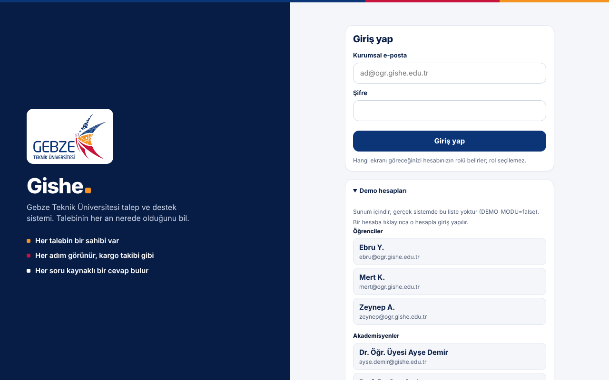
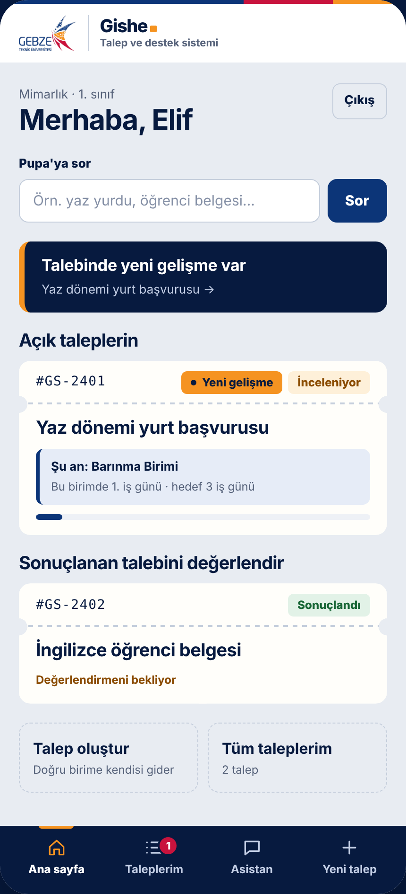
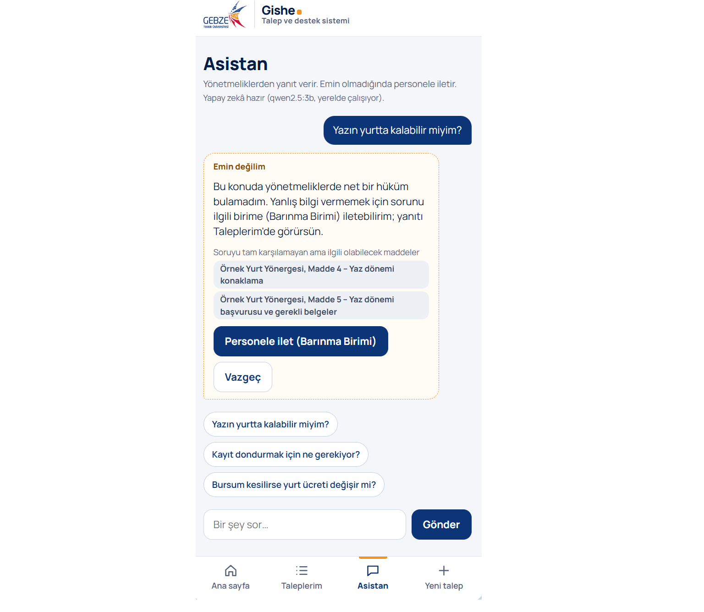
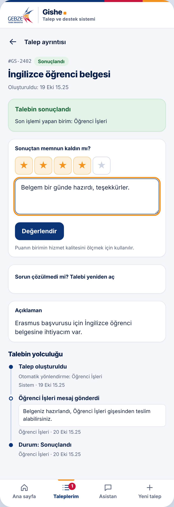
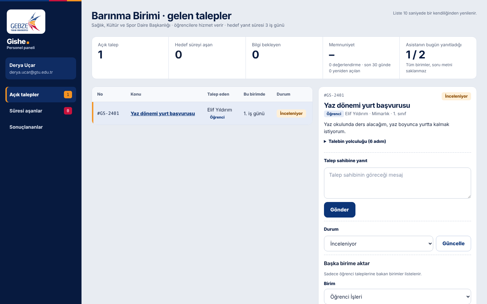
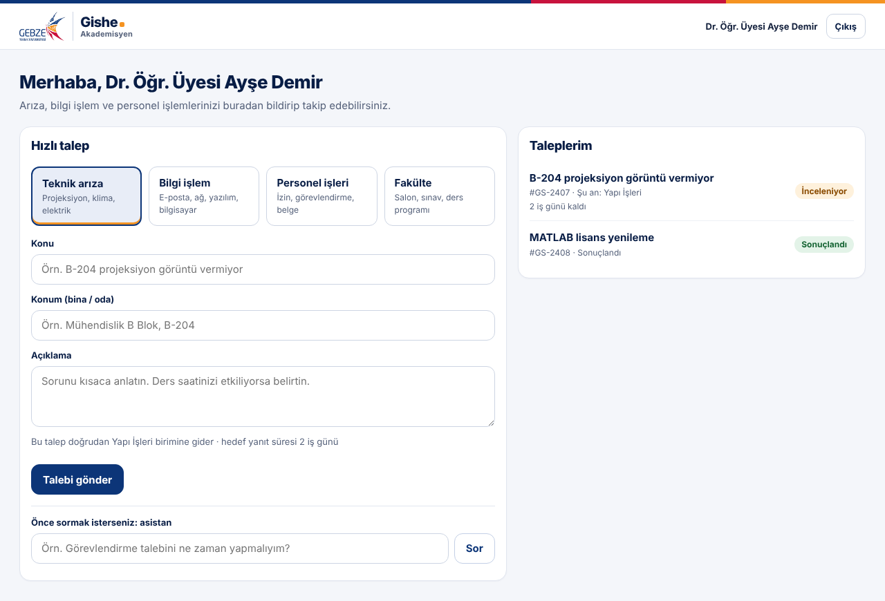

# Gishe

**Talebin her an nerede olduğunu bilen kampüs.**
Öğrenci İşleri ve idari birimler için talep takip sistemi ve yerel yapay zekâ asistanı.

> 🎬 **Demo videosu:** [Uygulamanın Docker ile açılışı ve kullanımı (3 dk)](BURAYA-VIDEO-BAGLANTISI)
>
> ▶️ **Çalıştırma:** `docker compose up --build` → arayüz **http://localhost:3000**, API **http://localhost:8000**

---

## İçindekiler
1. [Problem](#problem)
2. [Çözüm](#çözüm)
3. [Ekran görüntüleri](#ekran-görüntüleri)
4. [Çalıştırma](#çalıştırma)
5. [Mimari](#mimari)
6. [Yapay zekâ bileşeni](#yapay-zekâ-bileşeni)
7. [Ayarlar](#ayarlar)
8. [Güvenlik ve KVKK](#güvenlik-ve-kvkk)
9. [Görünüm](#görünüm)
10. [Proje yapısı](#proje-yapısı)
11. [Geliştiriciler](#geliştiriciler)
12. [Yapay zekâyı nasıl kullandık](#yapay-zekâyı-nasıl-kullandık)

---

## Problem

Bir öğrenci talebi (yurt başvurusu, belge, kayıt dondurma…) üniversitede birimden birime dolaşırken
**kimse talebin şu an kimde olduğunu bilmiyor.** Bunu dört sorun büyütüyor:

| Sorun | Ne oluyor? |
|---|---|
| Talep sahipsiz kalıyor | Birimler "bizde değil" deyince sorumluluğu kimse almıyor. |
| Süreç görünmüyor | Öğrenci talebinin nerede olduğunu, kaç gündür beklediğini göremiyor. |
| Birimlere ulaşılamıyor | Telefon açılmıyor; bilgi almanın tek yolu gişeye gitmek. |
| Personel bunalıyor | Aynı sorular her gün defalarca soruluyor; asıl işe zaman kalmıyor. |

Bu tablo kendi deneyimimizden (birimden birime gönderilen bir yaz yurdu başvurusu), arkadaşlarımızla
konuşmalarımızdan, GTÜ Öğrenci İşleri Daire Başkanlığı ile görüşmemizden ve üniversitelerin öğrenci
memnuniyeti verilerinden çıktı.

## Çözüm

Gishe üç söz verir: **her talebin bir sahibi var, her adım görünür, her soru bir cevap bulur.**

- **"Şu an kimde?"** Talep hangi birimde, kaç iş günüdür bekliyor, hedef süre ne; her an görünür.
- **Talebin yolculuğu:** Her adım zaman çizelgesinde görünür, kargo takibi gibi.
- **Gerekçeli aktarma:** Talep başka birime ancak gerekçe yazılarak aktarılır; talep sahibi gerekçeyi görür.
- **Otomatik yönlendirme:** Öğrenci birimi bilmek zorunda değil; sistem konuya göre doğru birimi seçer.
- **Hedef süre:** Her birimin hedef cevap süresi var; aşan talepler personel listesinde öne çıkar.
  Süre **iş günü** olarak sayılır: hafta sonları ve resmî tatiller (dinî bayramlar dahil) sayılmaz.
- **"Yeni gelişme" işareti:** Birim mesaj yazdığında, durumu değiştirdiğinde ya da talebi aktardığında talep sahibi
  ana sayfada ve menüde bunu görür. İstenirse e-posta ile de haber verilir (isteğe bağlı, mesaj içeriği e-postaya yazılmaz).
- **Değerlendirme:** Sonuçlanan talep 1–5 yıldızla puanlanır, isteğe bağlı yorum yazılır.
  Birimin memnuniyet ortalaması personel panelinde görünür.
- **Yeniden açma:** Sorun çözülmediyse talep sahibi, sonuçlanmadan sonraki 30 gün içinde gerekçe yazarak talebi yeniden açabilir.
- **Yapay zekâ asistanı Pupa:** GTÜ'nün maskotu Pupa'nın yüzüyle konuşur. Yönetmeliklerden ve sık sorulan sorulardan,
  **kaynak göstererek** cevap verir. Türkçe karakter kullanılmadan yazılan soruları, kısaltmaları ("büt", "GANO") ve
  eş sesli kelimeleri ("yazın yurtta kalmak" / "dilekçe yazmak") anlar. Emin değilse **uydurmaz**; benzer soruları önerir
  ve soruyu tek dokunuşla doğru birime talep olarak iletir.
- **Üç rol, üç ekran:** Öğrenci, akademisyen ve birim personeli. Rol **seçilemez**; hesaptan gelir
  ve her istekte sunucuda kontrol edilir.

## Ekran görüntüleri

| Giriş | Öğrenci ana sayfası |
|---|---|
|  |  |
| Kurumsal hesapla giriş. Rol seçilmez, hesaptan gelir. | "Şu an kimde?", yeni gelişme işareti ve değerlendirme bekleyen talep. |

| Asistan Pupa | Değerlendirme |
|---|---|
|  |  |
| Yönetmelikten kaynak göstererek cevap; emin değilse benzer soruları önerir ve personele iletmeyi teklif eder. | Sonuçlanan talebe yıldız ve yorum; çözülmediyse yeniden açma. |

| Birim personeli | Akademisyen |
|---|---|
|  |  |
| Sadece kendi biriminin talepleri, özet sayılar, yanıt, durum ve gerekçeli aktarma. | Arıza, bilgi işlem, personel işleri ve fakülte için hızlı talep; Pupa'ya soru. |

## Çalıştırma

### Gerekenler
- [Docker Desktop](https://www.docker.com/products/docker-desktop/) (Windows'ta WSL 2 ile). `docker run hello-world` çalışıyorsa hazırsınız.
- İnternet bağlantısı (sadece ilk derlemede) ve yaklaşık **20 GB boş disk**. GPU **gerekmez**.

### Tek komut

```bash
git clone https://github.com/KULLANICI-ADI/gishe.git
cd gishe
docker compose up --build
```

- İlk derleme internet hızına göre **20–60 dakika** sürebilir: Python, Node, nginx ve Ollama imajları
  (yaklaşık 4 GB) ile 2 GB'lık Qwen modeli indirilir. Model **derleme sırasında otomatik** iner;
  elle dosya kopyalamak gerekmez. Sonraki açılışlar saniyeler sürer.
- Hazır olunca:

| Ne | Adres |
|---|---|
| **Arayüz** | http://localhost:3000 |
| **API** | http://localhost:8000 |
| API belgeleri (Swagger) | http://localhost:8000/docs |
| Durum (health) | http://localhost:8000/health |

- `.env` dosyası **zorunlu değildir**; ayar değiştirmek isterseniz `.env.example` dosyasını `.env` adıyla kopyalayın.
- Durdurmak: `Ctrl + C` ya da `docker compose down`. Verileri de silmek: `docker compose down -v`.

### Test hesapları
Her rolden üç hesap vardır. **Kişiler kurgusaldır**; bu hesaplara e-posta bildirimi gönderilmez.
Şifreler kodda değil, `.env.example` dosyasında **örnek değer** olarak durur; `docker compose` bu dosyayı
varsayılan olarak okur, `.env` varsa onun değerleri geçerli olur.

| Rol | Ad | E-posta | Şifre | Ne görür? |
|---|---|---|---|---|
| Öğrenci | Elif Yıldırım (Mimarlık, 1. sınıf) | `e.yildirim2026@gtu.edu.tr` | `7S2RVM-39sc` | Kendi talepleri, "şu an kimde?", asistan Pupa |
| Öğrenci | Mert Kaya (İnşaat Müh., 2. sınıf) | `m.kaya2025@gtu.edu.tr` | `miDua3-quFq` | 〃 |
| Öğrenci | Zeynep Aksoy (Moleküler Biyoloji ve Genetik, 3. sınıf) | `z.aksoy2024@gtu.edu.tr` | `FMEfTh-tX4M` | 〃 |
| Akademisyen | Dr. Öğr. Üyesi Selin Ergüven (Bilgisayar Müh.) | `selin.erguven@gtu.edu.tr` | `8tdKgy-mK2z` | Arıza / bilgi işlem / personel işleri talepleri, asistan |
| Akademisyen | Prof. Dr. Tarık Bozdağ (İnşaat Müh.) | `tarik.bozdag@gtu.edu.tr` | `zvnkKd-8pBs` | 〃 |
| Akademisyen | Doç. Dr. Nihan Karaca (Elektronik Müh.) | `nihan.karaca@gtu.edu.tr` | `SfxAqk-Z83U` | 〃 |
| Personel | Gökhan Şeker (Öğrenci İşleri) | `gokhan.seker@gtu.edu.tr` | `qimTr2-6ETt` | Sadece kendi biriminin talepleri, yanıtlama, gerekçeli aktarma |
| Personel | Derya Uçar (Barınma Birimi) | `derya.ucar@gtu.edu.tr` | `pxTqm8-XNqp` | 〃 |
| Personel | Serkan Avcı (Yapı İşleri) | `serkan.avci@gtu.edu.tr` | `AxM2K6-xM2E` | 〃 |

Fakülte Sekreterliği, Strateji Geliştirme, Bilgi İşlem ve Personel Daire Başkanlığı da sistemde birim olarak
vardır ve talepler bu birimlere yönlenir; bu dört birim için test hesabı açılmamıştır.

Gerçek kullanımda `.env` içinde bu şifre değişkenlerini boş bırakın (ör. `OGRENCI1_SIFRE=`); şifresi
olmayan hesap girişe kapanır. Şifreler veritabanında düz değil, özetlenerek saklanır.

### Kısa deneme senaryosu
1. **Elif** ile girin → *Yaz dönemi yurt başvurusu* talebinde "Şu an kimde?" kartına ve aktarma gerekçesine bakın.
2. Asistan **Pupa**'ya "Yazın yurtta kalabilir miyim?" diye sorun → kaynaklı cevap.
3. "Bursum kesilirse yurt ücreti değişir mi?" → Pupa emin değilse **Personele ilet**.
4. Çıkış yapıp **Derya Uçar** (Barınma Birimi) ile girin → talep listede. Gerekçe yazmadan aktarmayı deneyin: sistem izin vermez.

## Mimari

```
 Tarayıcı ──► frontend (nginx, :3000) ──/api──► backend (FastAPI, :8000) ──► ollama (Qwen, yerel)
                derlenmiş HTML/CSS/JS              iş mantığı, roller,          açık kaynak model,
                                                   RAG asistanı, /health        CPU'da çalışır
                                                        │
                                                        ▼
                                                 SQLite (kalıcı Docker birimi)
```

| Servis | Klasör | Görevi |
|---|---|---|
| `frontend` | `frontend/` | Arayüz. `npm run build` ile derlenir, derlenmiş hâli **nginx** ile sunulur (geliştirme sunucusu yok). Arka uca **sadece API** üzerinden bağlanır. |
| `backend` | `backend/` | FastAPI API'si: giriş, roller, talepler, aktarma, istatistik, asistan. Durumunu **`/health`** ile bildirir. |
| `ollama` | `ollama/` | Açık kaynak dil modeli (Qwen 2.5). Model imaj derlenirken indirilir. Dışarıya açık değildir. |

Arayüz API'ye iki yoldan ulaşabilir: varsayılan olarak aynı adresten (`/api`, nginx arka uca iletir)
ya da `.env` içinde `API_URL=http://localhost:8000` verilirse doğrudan (arka uç bu kaynağa CORS izni verir).

## Yapay zekâ bileşeni

**Konteyner içinde yerel çalışan açık kaynak bir dil modeliyle kurulmuş LLM özelliği: asistan Pupa.**

- **Model:** Qwen 2.5 (varsayılan `qwen2.5:3b`), Ollama ile, **tamamen yerelde ve CPU'da**.
  Daha hızlı cevap için `.env` içinde `MODEL=qwen2.5:1.5b` yapılabilir.
- **Harici yapay zekâ API'si yoktur.** Ürün hiçbir bulut servisine (Claude, OpenAI, Gemini…) istek atmaz.

**Bir soru gelince sırasıyla** (`backend/asistan.py`, `backend/dil.py`):

1. **Sohbet mi?** "Merhaba", "teşekkürler", "sen kimsin?" gibi mesajlara kısa sohbet cevabı verilir; yönetmelikte aranmaz.
2. **Soruyu anlama (Türkçe dil katmanı).** Öğrenciler yönetmelik diliyle değil günlük dille soru sorar:
   - Türkçe karakter olmadan yazılan sorular ("kayit dondurma") ve ekli kelimeler ("kaydımı", "yurtlarda") kök hâline getirilir.
   - Kısaltmalar ve günlük ifadeler yönetmelik diline çevrilir: "büt" → "D sınavı", "GANO" → "ağırlıklı genel not ortalaması",
     "bölüm değiştirmek" → "yatay geçiş", "Erasmus" → "değişim programı".
   - **Eş sesli kelimelerin** anlamı cümlenin geri kalanına bakarak seçilir; yanlış anlam aramadan çıkarılır:

     | Kelime | Örnek | Pupa'nın anladığı |
     |---|---|---|
     | yaz | "**Yazın** yurtta kalabilir miyim?" / "Dilekçe nasıl **yazılır**?" | yaz dönemi / yazmak (aranmaz) |
     | kal | "Dersten **kaldım**" / "Yurtta **kalmak**" / "Tek dersim **kaldı**" | başarısızlık / konaklama / tek ders sınavı |
     | geç | "Dersi **geçmek**" / "Başka bölüme **geçmek**" / "Kayda **geç** kaldım" | başarı / yatay geçiş / mazeretli kayıt |
     | kredi | "Kaç **kredi** ders alabilirim?" / "KYK **kredim** kesildi" | AKTS / öğrenim kredisi (üniversitenin konusu değil) |
     | bırak | "Dersi **bırakmak**" / "Okulu **bırakmak**" | ders ekleme-çıkarma / üniversiteden ayrılma |
     | rapor | "**Rapor** aldım, sınava giremedim" / "Staj **raporu**" | mazeret / staj raporu |
     | yurt | "**Yurt**ta kalmak" / "**Yurt** içi görevlendirme" | yurt binası / ülke içi |
3. **Sık sorulan sorular** (`backend/sss.txt`). En sık sorulan 74 konu için (260'ı aşkın farklı söyleyişle) yönetmelik maddelerinden yazılmış hazır
   cevaplar vardır. Soru bunlardan birine yeterince benziyorsa cevap **anında** ve kaynağıyla verilir. Her hazır cevap bir
   yönetmelik maddesine bağlıdır; kaynağı bulunamayan cevap sisteme yüklenmez.
4. **RAG ("bul, sonra cevapla").** Listede olmayan sorularda `backend/yonetmelikler/` içindeki maddeler arasında en ilgilileri
   bulunur (seyrek ve konu belirleyen kelimeler ağır sayılır, madde ve metin başlığında geçen kelimeler öne çıkar) ve
   **sadece bu maddeler** Qwen'e verilir. Modele iki örnek soru-cevap da gösterilir: biri metinden cevaplanan, biri
   "BILMIYORUM" denmesi gereken.
5. **Model cevabının denetimi.** Küçük modeller hata yapabilir; bu yüzden cevap kullanıcıya gösterilmeden önce denetlenir.
   Cevapta metinde olmayan bir **sayı** (rakamla ya da yazıyla) varsa, cevap maddeye **dayanmıyorsa**, talimattaki örneklerden
   bilgi taşıdıysa, "daha fazla bilgi gerekir" gibi **kaçamak** bir cümleyse ya da Türkçe dışında bir yazıya kaydıysa gösterilmez.
   Gösterilen her model cevabının altında maddenin kendi cümleleri de **"Yönetmelikte yazan"** başlığıyla verilir; kullanıcı
   özeti asıl metinle karşılaştırabilir. Madde soruyu çok güçlü karşılıyorsa yerine maddenin
   soruyla ilgili cümleleri aynen alıntılanır; değilse asistan "emin değilim" der.
6. **Uydurmama.** İlgili madde yoksa Pupa "emin değilim" der, **"Bunu mu demek istedin?"** diye benzer soruları önerir ve
   soruyu doğru birime talep olarak iletmeyi teklif eder. "burs" gibi tek kelimelik sorularda hangi konuyu kastettiğini sorar.

- **Yedek mod:** Model henüz yüklenmediyse veya cevap gecikirse uygulama çökmez; sık sorulan sorular ve madde
  alıntılarıyla çalışmaya devam eder. Asistan ekranında modelin durumu yazar.
- **Hız:** Sık sorulan sorular anında cevaplanır. Modele giden sorularda bağlam ve cevap uzunluğu sınırlıdır
  (`MODEL_EN_FAZLA_TOKEN`); sabit talimat kısmı Ollama'nın önbelleğinden kullanılır, model açılışta belleğe yüklenir.
- **Ölçüm:** `backend/soru_seti.py` içinde yaklaşık 400 gerçekçi soru vardır: temel sorular, sonradan farklı söyleyişlerle
  yazılan ek sorular ve metne benzeyen ama cevabı olmayan tuzak sorular (Türkçe karaktersiz yazım, kısaltma ve eş sesli
  kelimeler dahil). `docker compose exec backend python test_asistan.py` ile ölçülür. Model kapalıyken (en kötü durum)
  sonuç: **%96 doğru, 0 yanlış cevap**; kalan sorularda asistan uydurmak yerine "emin değilim" der.
  Gerçek modelle denemek için: `docker compose exec backend python deneme_model.py`.
- Görüntü işleme yapılmaz; **YOLO ailesinden hiçbir model kullanılmaz.**

> **Bilgi kaynağı (`backend/yonetmelikler/`):**
> - GTÜ'nün resmî metinlerinden dönüştürülenler: Ön Lisans ve Lisans Eğitim-Öğretim Yönetmeliği, Yatay Geçiş Yönergesi,
>   Yan Dal Programı Yönergesi, Mühendislik ve İşletme Fakültesi staj yönergeleri, GTÜ Vakfı burs bilgileri.
> - Demo için hazırlanmış **örnek** metinler (dosya adında `ornek` geçer): yurt, harç iadesi, bilgi işlem,
>   teknik hizmetler ve akademik personel işlemleri. Gerçek kullanımda üniversitenin metinleriyle değiştirilir.
> - Yeni bir metin eklemek için aynı biçimde `.txt` dosyası koyup `docker compose up --build` demek yeterlidir;
>   model değişmez, imaj boyutu sadece birkaç KB artar.

## Ayarlar

Tüm ayarlar ortam değişkenlerinden okunur; koda gömülü port, adres veya model yolu yoktur.
Örnek değerler: [`.env.example`](.env.example).

| Değişken | Varsayılan | Açıklama |
|---|---|---|
| `FRONTEND_PORT` | `3000` | Arayüzün bilgisayardaki portu |
| `API_PORT` | `8000` | API'nin bilgisayardaki portu |
| `MODEL` | `qwen2.5:3b` | Ollama modeli (değişirse `--build` gerekir) |
| `MODEL_ZAMAN_ASIMI` | `120` | Modelden cevap bekleme süresi (sn) |
| `MODEL_EN_FAZLA_TOKEN` | `220` | Cevap uzunluğu sınırı |
| `API_URL` | *(boş)* | Arayüzün API adresi; boşsa aynı adres + nginx |
| `CORS_KAYNAKLARI` | `http://localhost:3000,http://127.0.0.1:3000` | API'ye doğrudan erişebilecek adresler |
| `OTURUM_SAAT` | `12` | Oturum süresi |
| `GUVENLI_CEREZ` | `false` | HTTPS arkasında `true` |
| `DEMO_MODU` | `true` | Personel ekranında "Örnek verileri sıfırla" düğmesi |
| `OGRENCI1_SIFRE` … `PERSONEL3_SIFRE` | `.env.example`'daki örnekler | Test hesaplarının şifreleri; boşsa hesap girişe kapanır |
| `GIRIS_DENEME_SINIRI` | `10` | Bir hesaba bu kadar hatalı şifre girilirse hesap geçici olarak kilitlenir |
| `GIRIS_KILIT_DAKIKA` | `15` | Kilit süresi (dakika) |
| `EK_TATILLER` | *(boş)* | Resmî tatillere ek, iş günü sayılmayacak günler (`2026-10-30,2027-05-20`) |
| `YENIDEN_ACMA_GUN` | `30` | Sonuçlanan talep kaç gün içinde yeniden açılabilir |
| `SMTP_SUNUCU` | *(boş)* | E-posta bildirimi için sunucu; boşsa e-posta gönderilmez |
| `SMTP_PORT`, `SMTP_KULLANICI`, `SMTP_SIFRE`, `SMTP_GONDEREN` | `587`, *(boş)* | E-posta hesabı bilgileri (sadece `.env` içinde) |
| `SMTP_GUVENLIK` | `starttls` | `starttls`, `ssl` veya `yok` |
| `UYGULAMA_URL` | `http://localhost:3000` | E-postadaki bağlantının açacağı adres |

## Güvenlik ve KVKK

- **Depoda gerçek şifre ve gizli bilgi yoktur.** Ayarlar `.env` dosyasındadır ve `.gitignore` ile dışarıda tutulur.
  `.env.example` sadece örnek değerler içerir; kurgusal test hesaplarının şifreleri de bunlardandır.
- Şifreler veritabanında düz değil, tuzlanıp özetlenerek (PBKDF2-SHA256, 600.000 tur) saklanır. Oturum anahtarı JavaScript'in okuyamadığı bir çerezdedir.
- Bir hesaba art arda hatalı şifre girilirse hesap geçici olarak kilitlenir (kaba kuvvet denemelerine karşı).
  Hata mesajı e-postanın mı şifrenin mi yanlış olduğunu söylemez.
- Rol tarayıcıdan değil veritabanından gelir; her istekte sunucuda kontrol edilir. Öğrenci "akademisyen gibi" talep açamaz.
- Her kullanıcı sadece kendi taleplerini, her personel sadece kendi biriminin taleplerini görür.
- Asistana sorulan **soru metni saklanmaz**; istatistik için sadece zaman ve "cevaplandı / cevaplanamadı" bilgisi tutulur.
- Yapay zekâ üniversitenin kendi sunucusunda çalışır; öğrenci verisi dış bir şirkete gönderilmez.
- E-posta bildirimi isteğe bağlıdır ve e-postada **mesajın içeriği yer almaz**; sadece talep numarası, konu ve
  uygulamanın bağlantısı bulunur. Ayrıntı ancak giriş yapılarak görülür.
- Hatalı veya eksik girdi uygulamayı çökertmez; kullanıcıya anlaşılır bir Türkçe hata mesajı gösterilir.

## Görünüm

Arayüz Gebze Teknik Üniversitesi'nin kurumsal renkleriyle (lacivert, kırmızı, turuncu) hazırlandı; üst şeritte ve giriş
ekranında GTÜ logosu, asistanın yanında GTÜ'nün maskotu Pupa yer alır. Öğrenci ekranı telefonda uygulama gibi kullanılacak
şekilde tasarlandı (alt menü: Ana sayfa, Taleplerim, Asistan, Yeni talep). Personel ve akademisyen ekranları masaüstü içindir.
GTÜ logosu ve maskotu üniversiteye aittir; bu projede yalnızca yarışma sunumu için kullanılmıştır.

## Proje yapısı

```
gishe/
├─ docker-compose.yml      Tüm servisleri tek komutla başlatır
├─ .env.example            Örnek ayarlar (gerçek .env depoya girmez)
├─ backend/                Arka uç (FastAPI)
│  ├─ Dockerfile
│  ├─ requirements.txt
│  ├─ main.py              API, roller, talepler, /health
│  ├─ ayarlar.py           Ortam değişkenlerinden ayar okuma
│  ├─ asistan.py           Asistan Pupa: sık sorulan sorular, RAG, model cevabının denetimi (Ollama'ya bağlanır)
│  ├─ dil.py               Türkçe dil katmanı: kök bulma, eş sesli kelimeler, kısaltmalar, sohbet mesajları
│  ├─ sss.txt              Sık sorulan sorular ve yönetmelik maddesine dayanan hazır cevaplar
│  ├─ yonetmelikler/       Asistanın bilgi kaynağı (GTÜ metinleri ve örnek metinler)
│  ├─ soru_seti.py         Asistanı ölçmek için ~400 gerçekçi soru
│  ├─ test_asistan.py      Ölçüm testi (model gerektirmez)
│  ├─ deneme_model.py      Asistanı gerçek modelle deneme betiği
│  ├─ bildirim.py          İsteğe bağlı e-posta bildirimi
│  └─ tatiller.py          Resmî tatiller (iş günü hesabı)
├─ frontend/               Ön yüz
│  ├─ Dockerfile           Derleme (Node) + sunum (nginx)
│  ├─ package.json, build.mjs
│  ├─ nginx/               Sunucu ayarı ve açılış betiği
│  └─ src/                 HTML, CSS, JavaScript, görseller (GTÜ logosu, maskot Pupa)
├─ ollama/
│  └─ Dockerfile           Qwen modelini derleme sırasında imaja indirir
└─ docs/                   Ekran görüntüleri
```

## Geliştiriciler

| | |
|---|---|
| **Yusuf Çelik** | Gebze Teknik Üniversitesi |
| **Alp Aslan** | Gebze Teknik Üniversitesi |

## Yapay zekâyı nasıl kullandık

**Araç:** Claude (Anthropic). Ürünün içinde **değil**, sadece geliştirme aracı olarak kullanıldı.
Ürün hiçbir bulut yapay zekâ servisine bağlanmaz; içindeki model yerel Qwen'dir.

**Hangi işlerde kullandık?**
- **Problemi anlamak ve fikir eleme:** Türkiye'deki üniversite sorunlarını konuştuk, fikirleri artı/eksi yönleriyle tarttık,
  Öğrenci İşleri görüşmesi için soru listesi hazırlattık.
- **Planlama:** Kabul ettiğimiz fikirleri tablo hâline getirip aşamalara böldük.
- **Kod:** FastAPI arka ucu, rol kontrolü, RAG asistanı, arayüz ve Docker yapılandırması asistanla birlikte yazıldı;
  her parçayı çalıştırıp deneyerek ilerledik.
- **Hata ayıklama:** Windows'ta Docker'ın "Virtualization support not detected" hatasını asistanla adım adım çözdük (`wsl --install`).
- **Sunum ve tasarım:** Sunum, arayüz tasarım seçenekleri ve logo üzerinde birlikte çalıştık.

**Örnek istemler**
- "Hocaların talepleriyle öğrencilerin taleplerine ayrı birimler baksa ve farklı arayüzleri olsa?"
- "Bu sunumdaki 5. sayfanın altındaki veriler kafa karıştırıcı, daha anlaşılır yap."
- "Yarışmanın kuralları bunlar; yaptıklarımızı bunlara uyacak şekilde revize et ve yapacaklarımızı adım adım yaz."

**Kendimiz düzelttiklerimiz ve verdiğimiz kararlar**
- **Rol güvenliği:** İlk tasarımda kullanıcı rolünü kendisi seçebiliyordu. Öğrencilerin "hoca" etiketiyle talep açabileceğini
  biz fark ettik; rolün girişte hesaptan gelmesini ve sunucuda kontrol edilmesini istedik.
- **KVKK:** Önerilen kalıcı "Belgelerim" arşivinin kişisel veriyi gereksiz yere sakladığını fark ettik; yerine talebe bağlı,
  süreli ve silinebilir belge fikrine geçtik.
- **Fikir eleme:** Teknik olarak iddialı olan otonom yoklama fikrini, asıl kullanıcısının (hocaların) ihtiyacı olmadığı için askıya aldık.
  Gişe sırası fikrini de Öğrenci İşleri ile görüştükten sonra askıya aldık.
- **İçerik:** Sunumdaki kafa karıştırıcı verileri ve uygunsuz ifadeleri ayıklattık; ilk logonun Google logosuna benzediğini
  fark edip değiştirttik.
- **Asistanın zayıflığı:** Denemelerde asistanın soru biraz farklı sorulunca şaşırdığını, "Yazın yurtta kalabilir miyim?"
  sorusunda "yaz" kelimesini "yazmak" sandığını gördük. Önce asistana, kendi sorularımızdan bir test seti hazırlattık;
  sonra her düzeltmeden sonra testi tekrar çalıştırdık. İlk ölçümde 190 sorunun yaklaşık yarısı doğruydu; sonunda 396 soruda
  %96 doğru ve 0 yanlış cevaba ulaştık.
- **Gerçek modelle deneme:** Testler model kapalıyken geçiyordu, ama Qwen'i kendi bilgisayarımızda çalıştırınca
  (`deneme_model.py`) modelin cevaba "kimlik kartı" gibi örnekten bilgi kattığını, "üç yıl" yerine "iki yıl" dediğini ve araya
  Çince karakter kaçırdığını gördük. Bu çıktıları paylaşıp modelin cevabını denetleyen kontrolleri istedik; denetimden geçmeyen
  cevapta yönetmelikteki cümlenin aynen gösterilmesine biz karar verdik.
- **Teslim kuralları:** Asistanın önerdiği her değişikliği kendi bilgisayarımızda çalıştırıp kontrol ettikten sonra kendi
  hesaplarımızdan commit'ledik. `.env` dosyasının depoya girmemesine ve ürünün hiçbir bulut yapay zekâ servisine
  bağlanmamasına dikkat ettik.

## Telif

© 2026 Yusuf Çelik, Alp Aslan. Tüm hakları saklıdır.
Bu depo yarışma değerlendirmesi için herkese açıktır; kod izinsiz kopyalanamaz, çoğaltılamaz ve dağıtılamaz.
